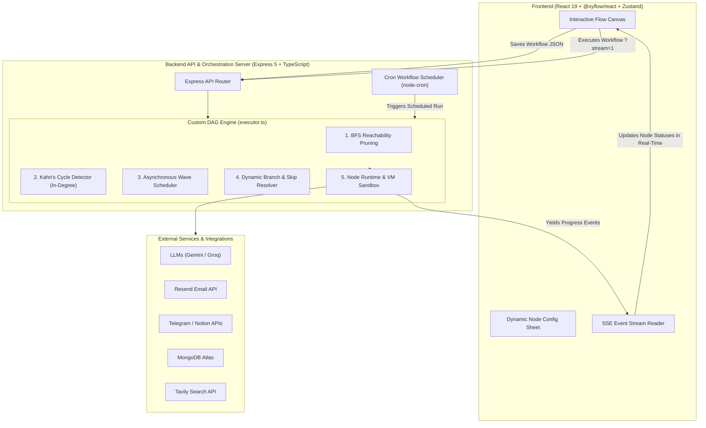

# ⚡ WorkflowAutomation — Visual AI & DAG Workflow Automation Platform

[](https://www.typescriptlang.org/)
[](https://react.dev/)
[](https://reactflow.dev/)
[](https://nodejs.org/)
[](https://expressjs.com/)
[](https://www.mongodb.com/)
[](https://tailwindcss.com/)

An open-source, full-stack visual workflow automation engine and drag-and-drop orchestration platform. Build complex pipelines integrating LLMs, APIs, databases, logic controls, and automated cron schedules with a custom dependency-driven DAG runtime and real-time streaming execution.

---

## 🚀 Key Highlights

- **Visual Graph Builder**: Powered by React 19 and `@xyflow/react` (React Flow), featuring custom node rendering, multi-handle condition routing, and interactive parameter sheets.
- **Custom DAG Execution Engine**:
  - **BFS Reachability Analysis**: Prunes disconnected nodes and establishes valid subgraphs from Trigger roots.
  - **Kahn's Topological Cycle Detection**: Detects cyclic graphs upfront to protect against infinite loops.
  - **Asynchronous Wavefront Execution**: Evaluates in-degree counts dynamically and runs non-dependent nodes concurrently in parallel batches (`Promise.all`).
  - **Dynamic Branch Resolution & Skip Propagation**: Intelligently disables unselected branches (`If/Else`, `Switch`) and propagates skipped states downstream without deadlocking parent dependencies.
  - **Dynamic Templating & Multi-Parent Merging**: Interpolate outputs between nodes using `{{prev.field}}` or merge outputs from multi-parent convergence.
- **Real-Time Execution Streaming**: Live SSE (Server-Sent Events) pipeline reporting granular node lifecycles (`node_start`, `node_success`, `node_skipped`, `node_error`, `done`) with real-time UI canvas highlighting.
- **Autonomous Cron Scheduling**: Synchronizes user workflows with background cron timers (`node-cron`) for autonomous execution.
- **Sandboxed Script Execution**: Safely evaluate custom JavaScript logic inside isolated Node.js `vm` environments.

---

## 🏗️ Architecture Overview



---

## 🧩 Comprehensive Node Catalog

| Category | Node | Description |
| :--- | :--- | :--- |
| **Triggers** | **Manual Trigger** | Manually initiate workflow execution directly from the canvas interface. |
| | **Schedule Trigger** | Cron-based autonomous trigger running on predefined schedules. |
| **AI & LLMs** | **AI Chatbot** | Multi-provider LLM node supporting Google Gemini and Groq models with dynamic templated prompts. |
| | **AI Extractor** | Leverages LLMs to parse and extract structured JSON schemas from unstructured input. |
| **Logic & Flow** | **If / Else** | Conditional branching evaluating expressions and activating dedicated `true` or `false` handles. |
| | **Compare Values** | Evaluates mathematical and string conditions (`>`, `<`, `==`, `!=`, regex, etc.). |
| | **Check Empty** | Validates presence or nullability of payload attributes. |
| | **Filter Data** | Array transformation filtering collections by criteria. |
| | **Switch** | Multi-way case routing node directing payloads to distinct execution pathways. |
| **Integrations** | **HTTP Request** | Full REST client supporting `GET`, `POST`, `PUT`, `DELETE`, `PATCH` with custom headers and timeout management. |
| | **Database Query** | Connects to MongoDB to perform queries (`find`, `findOne`, `insertOne`, `updateOne`, `deleteOne`, `count`). |
| | **Send Email** | Transactional email dispatch powered by the Resend API. |
| | **Telegram Bot** | Delivers notifications and messages through Telegram Bot webhooks. |
| | **Notion** | Append page blocks and query databases in Notion workspaces. |
| | **Web Search** | Live internet search integration powered by Tavily API. |
| **Utilities** | **Code Runner** | Executes user-defined JavaScript inside a secure Node.js `node:vm` sandbox. |
| | **Data Extractor** | Regex and heuristic extraction of URLs, email addresses, phone numbers, and custom patterns. |
| | **Text Formatter** | String transformations (uppercase, lowercase, trimming, replacements, stringification, templating). |
| | **Delay** | Asynchronous execution pause for rate-limiting or synchronization. |
| | **Display Output** | Terminal node visualizing transformed data or raw responses. |

---

## ⚙️ The DAG Execution Engine

The core execution engine (`backend/src/executor.ts`) implements a topological graph evaluation algorithm:

1. **Reachability Analysis**:
   - Performs a Breadth-First Search (BFS) from the designated trigger node.
   - Isolates active components from disconnected draft nodes.
2. **Cycle Detection (Kahn's Algorithm)**:
   - Computes initial in-degree counts across all reachable nodes.
   - Verifies the graph is a Directed Acyclic Graph (DAG) before execution starts.
3. **Wavefront Concurrency**:
   - Nodes with zero pending dependencies form the active wave.
   - All nodes in a wave execute concurrently via `Promise.all`.
4. **Conditional Edge Transitions & Skip Propagation**:
   - When a branch node fires (e.g., `If/Else`), only edges corresponding to active condition handles are marked `active`.
   - Edges on deactivated branches decrement incoming dependency counters of target nodes without registering them as active parents.
   - Target nodes with zero active parents are recursively marked as `skipped`, ensuring downstream branches terminate gracefully without deadlock.
5. **Multi-Parent Aggregation**:
   - When multiple branches converge into a single target node, upstream outputs are aggregated into a composite dictionary.

---

## 🛠️ Tech Stack

### Frontend
- **Framework**: React 19 (TypeScript)
- **Bundler**: Vite 6
- **Graph & Flow Canvas**: `@xyflow/react` (React Flow 12)
- **State Management**: Zustand
- **Styling**: Tailwind CSS v4, Lucide React, Shadcn/UI primitives
- **Networking**: Axios & Native Fetch ReadableStream (SSE consumer)

### Backend
- **Runtime**: Node.js (ES Modules, TypeScript 5)
- **Server**: Express 5
- **Database**: MongoDB with Mongoose ODM
- **Security**: JWT Authentication, bcryptjs password hashing
- **Task Scheduling**: `node-cron`
- **Sandbox**: Node.js `node:vm`

---

## 📁 Project Directory Structure

```text
ai-workflow/
├── backend/
│   ├── src/
│   │   ├── auth.ts              # JWT authentication middleware
│   │   ├── db.ts                # Mongoose schemas (User, Workflow, NodeDefine)
│   │   ├── executor.ts          # Core DAG execution engine & node logic
│   │   ├── index.ts             # Express REST endpoints & SSE streaming route
│   │   ├── scheduler.ts         # node-cron scheduler for automated workflows
│   │   └── types/               # TypeScript definitions
│   ├── .env.example             # Backend environment template
│   ├── package.json
│   └── tsconfig.json
├── frontend/
│   ├── src/
│   │   ├── components/
│   │   │   ├── Createworkflow.tsx # Canvas editor and workflow management
│   │   │   ├── CustomNode.tsx     # Custom trigger and ordinary React Flow nodes
│   │   │   ├── Config.tsx         # Node configuration panel
│   │   │   ├── Triggersheet.tsx   # Node catalog selection drawer
│   │   │   ├── Home.tsx           # Workflow list and dashboard
│   │   │   └── Navbar.tsx         # App navigation and user session
│   │   ├── lib/
│   │   │   └── node-definitions.ts# Schema configurations and field descriptors
│   │   ├── store.ts               # Zustand global store & SSE execution listener
│   │   ├── App.tsx
│   │   └── main.tsx
│   ├── .env.example             # Frontend environment template
│   ├── package.json
│   └── vite.config.ts
└── README.md
```

---

## 🏁 Quickstart Guide

### Prerequisites
- Node.js 18+ installed
- MongoDB instance (Local or MongoDB Atlas)
- (Optional) API Keys for external services (Google Gemini, Groq, Resend, Tavily, Telegram, Notion)

### 1. Backend Setup

```bash
# Navigate to backend directory
cd backend

# Install dependencies
npm install

# Configure environment variables
cp .env.example .env
```

Edit `backend/.env`:
```env
MONGO_URI=mongodb+srv://<username>:<password>@<cluster>.mongodb.net/workflow_db
jwt_secret=your_super_secret_jwt_key
PORT=8000
FRONTEND_URL=http://localhost:5173
ALLOW_APP_DB_QUERY=false
REQUIRE_AUTH_FOR_EXECUTE=false

# Optional external integration keys:
RESEND_API_KEY=
TAVILY_API_KEY=
TELEGRAM_BOT_TOKEN=
NOTION_API_KEY=
```

Start the backend service:
```bash
# Development mode (compiles TypeScript & starts server)
npm run dev
```

### 2. Frontend Setup

```bash
# Navigate to frontend directory
cd ../frontend

# Install dependencies
npm install

# Configure environment variables
cp .env.example .env
```

Ensure `frontend/.env` points to the backend:
```env
VITE_API_BASE=http://localhost:8000
```

Start the Vite development server:
```bash
npm run dev
```

Open your browser at `http://localhost:5173`.

---

## 📡 API Reference

### Authentication
- `POST /signup` — Register a new user (`{ username, password }`).
- `POST /login` — Authenticate and receive a JWT (`{ username, password }`).

### Workflows
- `GET /workflows` — List workflows for the authenticated user.
- `GET /workflows/:id` — Retrieve a specific workflow configuration.
- `POST /workflows` — Create and save a new workflow canvas.
- `PUT /workflows/:id` — Update existing workflow graph nodes and edges.
- `DELETE /workflows/:id` — Delete a workflow.

### Execution
- `POST /workflows/execute?stream=1` — Stream live workflow execution via Server-Sent Events (SSE).
- `POST /workflows/:id/execute` — Execute a saved workflow by its ID.

---

## 🛡️ License

This project is licensed under the [ISC License](LICENSE).
